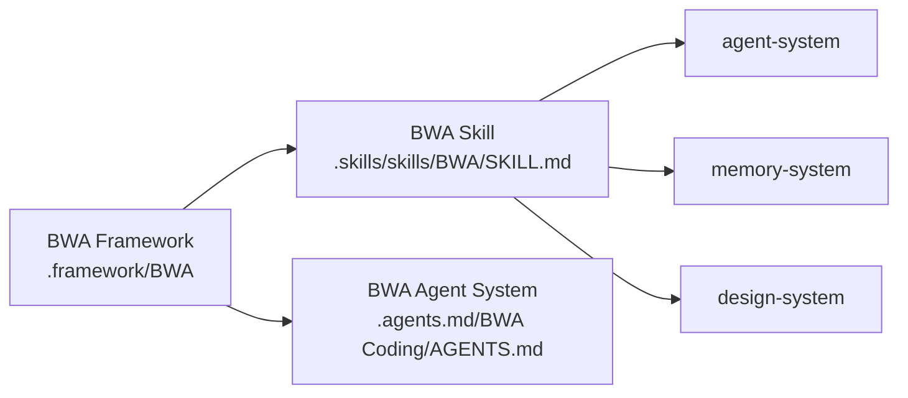

# BWA Framework

> **Purpose**: BWA (Building With AI) philosophy — the what to implement when building software, design, video/image-gen with AI. Workflows live in the BWA skill. Coding rules live in the BWA agent system.

## Layers

| Layer | Role | Path |
| :--- | :--- | :--- |
| Framework | Philosophy to be implemented | `.framework/BWA/` (here) |
| Skill | Implementation workflows agents follow | `../../.skills/skills/BWA/SKILL.md` |
| Agent system | Global coding rules for any AI-built project | `../../.agents.md/BWA (Coding)/AGENTS.md` |

## Domains

| Domain | Status | Pointer |
| :--- | :--- | :--- |
| Coding | Stub index live, folder reserved | [coding/philosophy-index.md](coding/philosophy-index.md) |
| Video / Image-gen | Not started | Reserved for future domain folder |
| Design | Covered via design-system skill | `../../.skills/skills/BWA/design-system-architecture/SKILL.md` |
