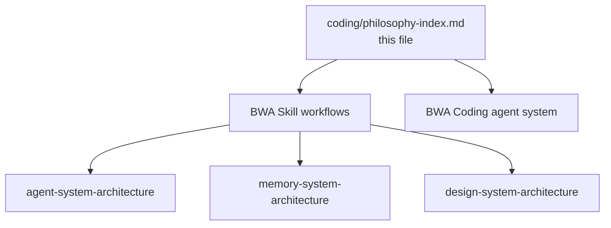

# BWA Coding Philosophy Index

> **Scope**: Stub only. `coding/` stays otherwise empty for now. Lists philosophies already noted down elsewhere plus exact paths to workflows and rules.



## 1. System Architectures Already Noted Down

| Philosophy | What it declares | Workflow path |
| :--- | :--- | :--- |
| Agent system | Progressive-disclosure AGENTS.md + .rules router, anti-micro-file, trigger contract | `../../../.skills/skills/BWA/skills/agent-system-architecture/SKILL.md` |
| Memory system | Root memory.md + flat .memory decision logs, Date/Decision/Why/Alternatives | `../../../.skills/skills/BWA/skills/memory-system-architecture/SKILL.md` |
| Design system | Root design.md + flat .design tokens and atomic recipes, living revamp sync | `../../../.skills/skills/BWA/skills/design-system-architecture/SKILL.md` |
| Hub router | Picks the subsystem above from natural phrases like use your agent system skill | `../../../.skills/skills/BWA/SKILL.md` |

> [!NOTE]
> Framework notes the philosophy. Skill implements it. Never duplicate subsystem workflows here.

## 2. BWA Coding Rules From the Agent System

Source: `../../../.agents.md/BWA (Coding)/AGENTS.md`

### Invariants

1. Truth First — codebase facts and tests only.
2. Minimalism and surgical changes only.
3. Exclusively pnpm with workspace protocol.
4. Zero RLS bypasses.
5. Brad Frost Atomic Design hierarchy.
6. Zero guesswork — Context7 and DeepWiki first, no any.
7. Progressive rule loading before domain work.
8. Mandatory doc-writing standard for all .md outputs.
9. Universal design system lock via design.md and .design.

### Domain Rule Clusters

| Domain | Rule file |
| :--- | :--- |
| Core and orchestration | `../../../.agents.md/BWA (Coding)/.rules/core-orchestration.rules.md` |
| Frontend architecture | `../../../.agents.md/BWA (Coding)/.rules/frontend-architecture.rules.md` |
| Backend and Supabase | `../../../.agents.md/BWA (Coding)/.rules/backend-supabase.rules.md` |
| Data fetching and realtime | `../../../.agents.md/BWA (Coding)/.rules/data-fetching-realtime.rules.md` |
| Security and threats | `../../../.agents.md/BWA (Coding)/.rules/security-threat-mitigation.rules.md` |
| Workspace and tooling | `../../../.agents.md/BWA (Coding)/.rules/workspace-engineering.rules.md` |

## 3. Global Agent Rule for Coding With AI in Any Project

The portable global rule to paste into any project's root `AGENTS.md`:

```text
YOUR RULES ARE IN "<repo>/.agents.md/BWA (Coding)/AGENTS.md"
```

* Global coding entry point: `../../../.agents.md/BWA (Coding)/AGENTS.md`
* Portable project pointer stub: `../../../.agents.md/BWA (Coding)/ProjectAGENTS.txt`
* Distinct from Agents-OS governance at `../../../AGENTS.md` — do not mix platform rules with project coding rules.
